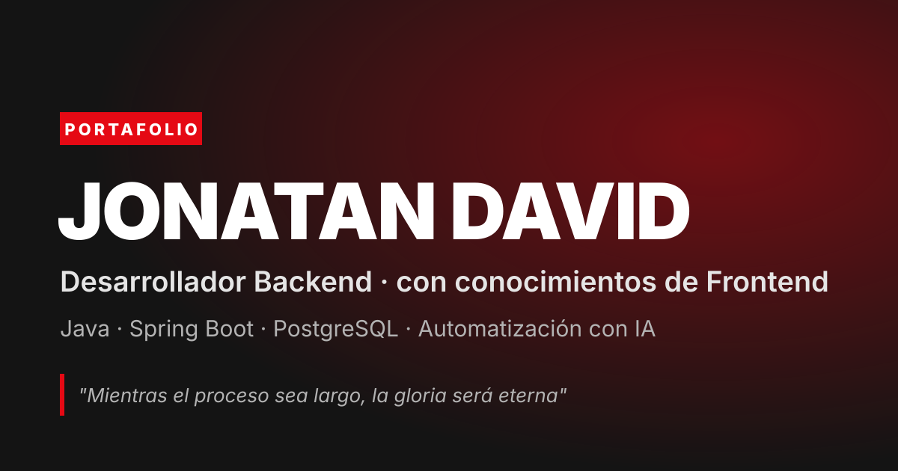

<div align="center">

# Portafolio · Jonatan David Sarmiento

### 👉 [Ver el portafolio en vivo](https://portafolio-jonatan.vercel.app) 👈

<a href="https://portafolio-jonatan.vercel.app"></a>

<a href="https://portafolio-jonatan.vercel.app"></a>

</div>

---

Portafolio personal con estilo inspirado en Netflix: proyectos en filas tipo catálogo, "tráiler" con capturas y detalles de cada proyecto, mi historia por temporadas y servicios freelance con una lista que se envía por WhatsApp o correo.

**Sitio:** https://portafolio-jonatan.vercel.app

**Hoja de vida:** [HDV_Jonatan_Sarmiento.pdf](assets/docs/HDV_Jonatan_Sarmiento.pdf) (español e inglés), también descargable desde el botón "Hoja de vida" del sitio.

## Tecnologías

HTML5, CSS3 y JavaScript sin frameworks. Publicado en Vercel.

## Estructura

```
index.html            Estructura y contenido
styles.css            Estilos (escritorio y celular)
script.js             Datos de proyectos y contacto, filas, tráiler, "Mi lista"
assets/proyectos/     Capturas y portadas de cada proyecto
assets/images/        Foto de perfil
assets/docs/          Hoja de vida en PDF
tools/portadas.py     Genera las portadas SVG, el favicon y la imagen para compartir
```

## Cómo editar

- **Proyectos:** objeto `proyectos` y filas `FILAS` en `script.js`. Las imágenes van en `assets/proyectos/<id>/`.
- **Contacto:** objeto `CONFIG` en `script.js` (WhatsApp, correo, LinkedIn, GitHub y hoja de vida).
- **Ver en local:** abre `index.html` con Live Server.

## Contacto

[LinkedIn](https://www.linkedin.com/in/jonatan-sarmiento-16a206366/) · [GitHub](https://github.com/Jonatan-17) · jonatandavidsarmientosierra@gmail.com
